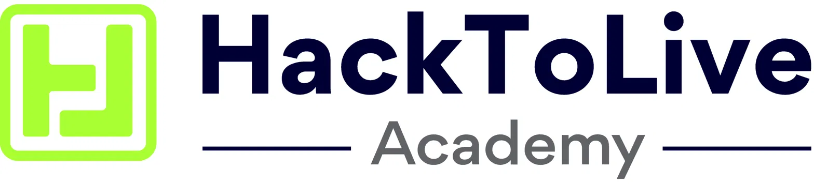
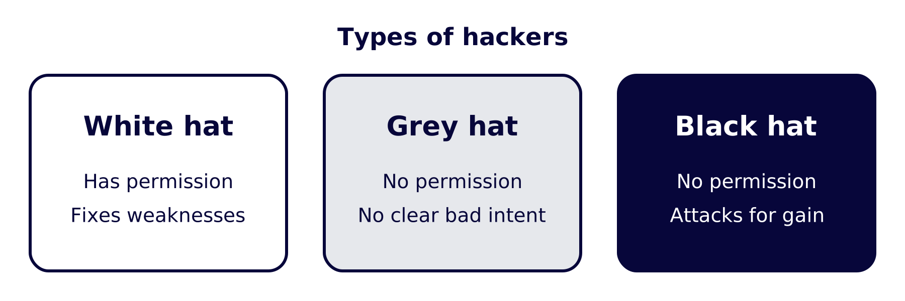
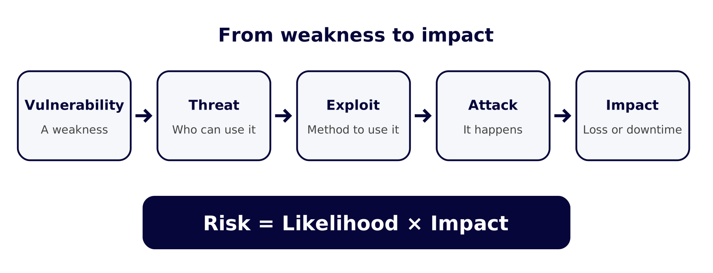
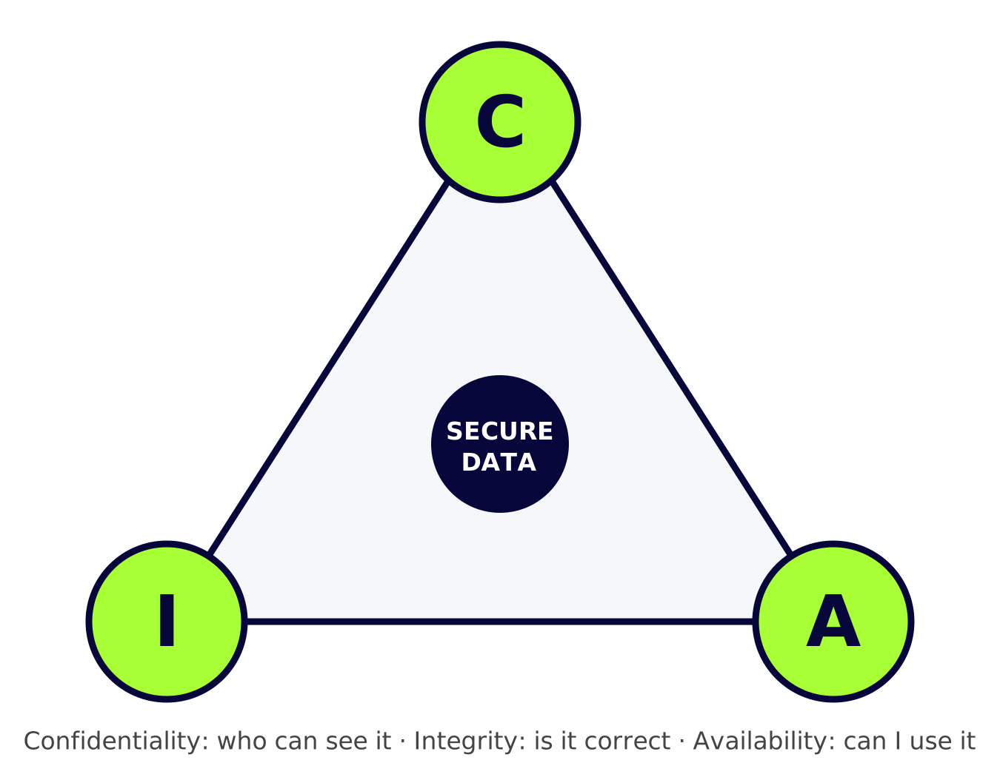
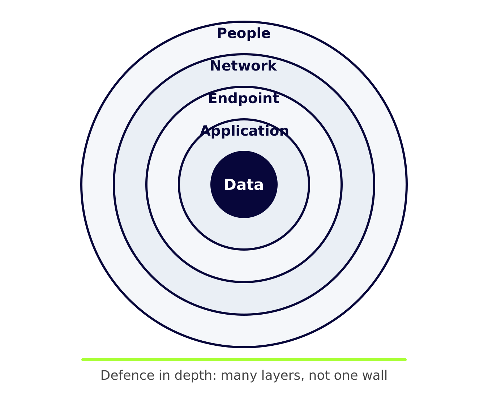
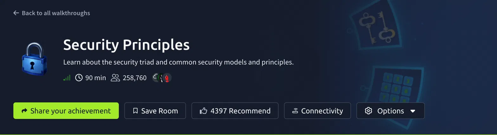

<p align="center"></p>

# Class 01: Cybersecurity & Ethical Hacking Fundamentals

**HackToLive Academy** · Beginner level · Lab: [TryHackMe – Security Principles](https://tryhackme.com/room/securityprinciples)

---

## Lesson 01: Information Security and Cybersecurity

- **Information security:** protecting any valuable information, whether on paper, on a computer or spoken.
- **Cybersecurity:** protecting digital systems, networks and data. It is one part of information security.
- **Why it matters:** attacks cause money loss, privacy loss, lost trust and service downtime.
- **Example:** a locked file cabinet is information security. A password on your phone is cybersecurity.


---

## Lesson 02: Types of Cybersecurity and Hackers

**Types of cybersecurity**

- **Network:** protects connections (firewall, VPN)
- **Application:** protects apps and websites (secure coding, patching)
- **Cloud:** protects online services (access rules, encryption)
- **Endpoint:** protects laptops and phones (antivirus, EDR)
- **Information:** protects the data itself (encryption, backups)

**Types of hackers**



- **White hat:** has permission, finds and fixes weaknesses.
- **Black hat:** no permission, attacks for money or damage.
- **Grey hat:** no permission, no clear bad intent, still illegal.

**Ethical hacking steps:** permission → scope → test → report → retest.

> Ethical hacking always needs written permission.

---

## Lesson 03: Vulnerability, Exploit, Threat, Risk and Attack

House example:

- **Vulnerability:** a weakness (a broken lock).
- **Exploit:** a way to use the weakness (a lockpick).
- **Threat:** something that can cause harm (a burglar nearby).
- **Risk:** chance of harm × its impact.
- **Attack:** the harm actually happening (the break-in).

```
Vulnerability → Threat → Exploit → Attack → Impact
Risk = Likelihood × Impact
```

Ways to handle risk: reduce, accept, transfer or avoid.



---

## Lesson 04: CIA Triad

<p align="center"></p>

- **Confidentiality:** only authorized people see the data. Controls: encryption, MFA, access control.
- **Integrity:** data stays accurate and unchanged. Controls: hashing, digital signatures, audit logs.
- **Availability:** systems work when needed. Controls: backups, redundancy, patching, recovery plan.

**Quick check**

| Scenario | Pillar |
|---|---|
| Customer database stolen | Confidentiality |
| Invoice amount changed | Integrity |
| Website down from DDoS | Availability |
| Ransomware locks files | Availability |

---

## Lesson 05: Security Principles

<p align="center"></p>

- **Least privilege:** give only the access needed.
- **Separation of duties:** split critical tasks between people.
- **Need to know:** access depends on job role.
- **Fail-safe defaults:** deny by default, allow what is approved.
- **Defence in depth:** many layers (people, network, endpoint, application, data).
- **Zero trust:** never trust by default, always verify.
- **Bell-LaPadula:** protects confidentiality (no read up, no write down).
- **Biba:** protects integrity (no read down, no write up).

---

## Lab



TryHackMe → **Security Principles** (~90 min)

- Create a free account and join the room.
- Read each task, then answer the questions.
- Write notes in your own words.

**Homework:** pick an app you use daily. Give one example each for C, I and A, and one control for each.
